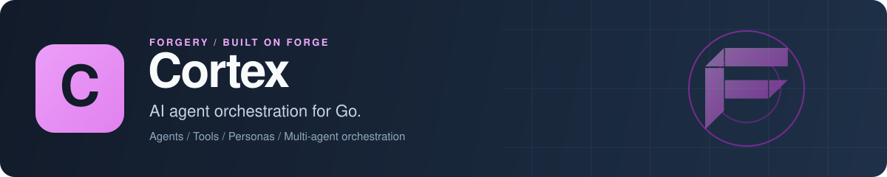

<p align="center">
  
</p>

# Cortex: AI agent orchestration framework for Go

Cortex is an open-source Go library for building LLM agents. You define an agent from a system prompt, tools and, if you want more structure, skills, personality traits, behaviors and personas, and Cortex runs it through a ReAct loop with tool calling, conversation memory, human-in-the-loop checkpoints and runs that suspend and resume. Several agents can work together through sequential, parallel, router, hierarchical and debate orchestration, or message each other directly. Everything is scoped to the tenants or workspaces your app defines, stored in PostgreSQL, SQLite or MongoDB, and works standalone or as a [Forge](https://github.com/xraph/forge) extension.

[](https://go.dev/dl/) [](https://github.com/xraph/cortex/actions/workflows/ci.yml) [](https://pkg.go.dev/github.com/xraph/cortex) [](https://github.com/xraph/cortex/stargazers)

[Documentation](https://www.xraph.com/docs/cortex) · [Quick start](#quick-start) · [Features](#why-cortex) · [Human model](#the-human-model) · [Orchestration](#multi-agent-orchestration) · [Forge](#use-it-with-forge) · [FAQ](#faq)

## Quick start

You need [Go 1.26 or later](https://go.dev/dl/) and an OpenAI API key. Cortex talks to models through an `llm.Client`, and the adapter that ships with it wraps a [Nexus](https://github.com/xraph/nexus) gateway, so you add Nexus and its OpenAI provider too:

```bash
go get github.com/xraph/cortex@latest
go get github.com/xraph/nexus@latest github.com/xraph/nexus/providers/openai@latest
go get github.com/xraph/grove/drivers/sqlitedriver@latest
```

Save this as `main.go`:

```go
package main

import (
	"context"
	"fmt"
	"log"
	"os"
	"time"

	"github.com/xraph/grove"
	"github.com/xraph/grove/drivers/sqlitedriver"
	_ "github.com/xraph/grove/drivers/sqlitedriver/sqlitemigrate" // registers the SQLite migration executor
	"github.com/xraph/nexus"
	"github.com/xraph/nexus/providers/openai"

	"github.com/xraph/cortex"
	"github.com/xraph/cortex/agent"
	"github.com/xraph/cortex/engine"
	"github.com/xraph/cortex/id"
	"github.com/xraph/cortex/llm"
	nexusllm "github.com/xraph/cortex/llm/nexus"
	sqlitestore "github.com/xraph/cortex/store/sqlite"
)

func main() {
	// Every stored row belongs to a scope you define. Cortex refuses to
	// read or write without one.
	ctx := cortex.WithScope(context.Background(), cortex.Scope{
		Levels: []cortex.Level{{Key: "workspace", Value: "acme"}},
	})

	// Storage: SQLite through Grove.
	drv := sqlitedriver.New()
	if err := drv.Open(ctx, "cortex.db"); err != nil {
		log.Fatal(err)
	}
	db, err := grove.Open(drv)
	if err != nil {
		log.Fatal(err)
	}
	st := sqlitestore.New(db)
	if err := st.Migrate(ctx); err != nil {
		log.Fatal(err)
	}

	// The model: OpenAI behind a Nexus gateway.
	gw := nexus.New(nexus.WithProvider(openai.New(os.Getenv("OPENAI_API_KEY"))))
	if err := gw.Initialize(ctx); err != nil {
		log.Fatal(err)
	}
	defer gw.Shutdown(ctx)

	// A tool the agent can call.
	clock := llm.Tool{
		Name:        "current_time",
		Description: "Returns the current time in UTC.",
		Parameters:  map[string]any{"type": "object", "properties": map[string]any{}},
	}
	tellTime := func(_ context.Context, _ cortex.Invocation) (string, error) {
		return time.Now().UTC().Format(time.RFC3339), nil
	}

	eng, err := engine.New(
		engine.WithStore(st),
		engine.WithLLM(nexusllm.New(gw)),
		engine.WithTool(clock, tellTime),
	)
	if err != nil {
		log.Fatal(err)
	}

	err = eng.CreateAgent(ctx, &agent.Config{
		ID:           id.NewAgentID(),
		Name:         "assistant",
		SystemPrompt: "You are a concise assistant. Use your tools when they help.",
		Model:        "gpt-4o-mini",
		MaxSteps:     5,
	})
	if err != nil {
		log.Fatal(err)
	}

	r, err := eng.RunAgent(ctx, "assistant", "What time is it in UTC right now?", nil)
	if err != nil {
		log.Fatal(err)
	}
	fmt.Println(r.State, r.StepCount, r.TokensUsed)
	fmt.Println(r.Output)
}
```

Run it:

```bash
go mod tidy
OPENAI_API_KEY=sk-... go run .
```

The model sees `current_time`, calls it, gets the timestamp back from your handler and answers with it. You'll see the run's final state, how many steps it took and the tokens used, then the answer. The run, every step and the tool call are now rows in `cortex.db`, so `eng.ListSteps` and `eng.ListToolCalls` can show you exactly what happened. Run it a second time and `CreateAgent` fails, because an agent named `assistant` already exists in that scope. Delete `cortex.db` or use `GetAgentByName` first.

If you leave out `WithLLM`, `RunAgent` still works, in an echo mode that's handy for wiring tests.

## Why Cortex?

Calling a chat API in a loop gets you an agent for a demo. Then you need the run history in a database, a person to approve a risky tool call, a run that can wait a day for an external result without holding a goroutine, and a guarantee that one customer's agents never read another's memory. Cortex handles those parts so your code only describes the agents and their tools.

| You need | Cortex gives you |
| --- | --- |
| An agent that uses tools | A ReAct loop over any `llm.Client`, with `engine.WithTool` handlers and a step limit per agent |
| A model gateway | The `llm/nexus` adapter, so routing, caching, budgets and guardrails come from [Nexus](https://github.com/xraph/nexus) |
| Agents with a consistent character | Skills, traits, behaviors, cognitive and communication styles, perception, and personas that compose them |
| A record of every run | Runs, steps and tool calls stored with state, token counts and timings |
| A person in the loop | Checkpoints, and a `ToolAuthorizer` that can hide tools, deny calls, or return `ErrRequiresApproval` to pause the run |
| Tools that run somewhere else | `engine.WithExternalTool`: the run suspends, your caller runs the tool, and `eng.Resume` continues it |
| Several agents on one task | Sequential, parallel, router, hierarchical and debate orchestration, plus agent-to-agent messages with a durable ask |
| Conversations that carry on | Sessions and conversation memory per agent |
| Isolation per customer | A scope you define (workspace, org, project) on every stored row, checked on every store call |
| Safety and retrieval | `safety/shield` for [Shield](https://github.com/xraph/shield) scans and `knowledge/weave` for [Weave](https://github.com/xraph/weave) retrieval, exposed to the agent as a `knowledge_search` tool |

## Scope comes first

Cortex has no built-in tenant. You decide the levels, in order, and put them on the context:

```go
ctx = cortex.WithScope(ctx, cortex.Scope{
	Levels: []cortex.Level{
		{Key: "org", Value: "acme"},
		{Key: "project", Value: "support"},
	},
})
```

Store methods read it back and return `cortex.ErrNoScope` when it's empty, so a scope you forgot to pass fails loudly and never becomes a query across every tenant. Lists match by prefix: a context scoped to `org=acme` sees every project under it. Keep the order of your levels stable between releases, because each position maps to an indexed column.

## The human model

You can run an agent on a plain system prompt. When you want reusable structure, Cortex gives you these building blocks, each with its own store and CRUD methods on the engine:

| Concept | Package | What it holds |
| --- | --- | --- |
| Skill | `skill` | Tool bindings, knowledge references, a prompt fragment and a proficiency level |
| Trait | `trait` | A personality dimension and how it shifts the agent's output |
| Behavior | `behavior` | Trigger and action patterns the agent follows |
| Cognitive style | `cognitive` | Thinking phases and strategies |
| Communication style | `communication` | Tone, formality and verbosity |
| Perception | `perception` | Attention filters and context window settings |
| Persona | `persona` | An identity plus assigned skills, traits, behaviors and the three styles |

Point an agent at a persona with `PersonaRef`, or list skills, traits and behaviors inline with `InlineSkills`, `InlineTraits` and `InlineBehaviors`. `RunOverrides` lets one run swap the model, persona, tools or session without changing the stored agent, and `CloneAgent` and `ClonePersona` copy one under a new name.

## Runs, checkpoints and suspension

`RunAgent` returns the finished `*run.Run`. `StreamAgent` sends `StreamEvent`s on a channel as the run goes: `run_started`, `step`, `tool_call`, `token`, `checkpoint`, `safety_block`, `suspended`, `done` and `error`.

A run pauses in two cases. Your `ToolAuthorizer` returns `ErrRequiresApproval` for a call, which creates a checkpoint that someone resolves with `eng.ResolveCheckpoint`. Or the model calls a tool you registered with `WithExternalTool`, and the run suspends until you call `eng.Resume(ctx, runID, engine.ResumeInput{ToolResults: ...})`. A suspended run is a stored row, not a blocked goroutine, so it survives a restart. Suspensions expire after a TTL you set with `WithSuspensionTTL` (zero turns expiry off).

## Multi-agent orchestration

You store an `orchestration.Config` with a strategy and the agents taking part, then run it by name whenever you need it:

| Strategy | Constant | How the agents work |
| --- | --- | --- |
| Sequential | `StrategySequential` | Each agent takes the previous agent's output |
| Parallel | `StrategyParallel` | All agents get the same input at once |
| Router | `StrategyRouter` | One agent picks which participant handles the input |
| Hierarchical | `StrategyHierarchical` | A manager hands work to workers |
| Debate | `StrategyDebate` | Agents argue and a judge decides |

```go
err := eng.CreateOrchestration(ctx, &orchestration.Config{
	Name:     "review",
	Strategy: orchestration.StrategySequential,
	Participants: []orchestration.Participant{
		{AgentName: "drafter"},
		{AgentName: "editor"},
	},
})
// ...
result, err := eng.RunOrchestration(ctx, "review", "Write release notes for v1.7")
```

Participants share a blackboard with the roster and earlier work. For agents that talk without a fixed plan, the `a2a` bus sends FIPA-ACL style messages between them: fire-and-forget sends, a mailbox, and an ask that suspends the asking run until a peer replies. Turn it on with `engine.WithA2A`. The `a2aremote` module speaks the Agent2Agent protocol over JSON-RPC, REST and SSE for agents in other services, though it isn't tagged yet.

## Storage

| Backend | Package | Notes |
| --- | --- | --- |
| PostgreSQL | `store/postgres`, `postgres.New(db *grove.DB)` | The first three scope levels get indexed columns |
| SQLite | `store/sqlite`, `sqlite.New(db *grove.DB)` | Good for one process and for tests |
| MongoDB | `store/mongo`, `mongo.New(db *grove.DB)` | Needs a replica set or sharded cluster |

Every store filters reads by the first three scope levels only. Levels past the third are saved with the row, in `scope_extra` and in the canonical scope string, but no query matches on them, so two scopes that differ only below the third level read each other's rows. Keep your scopes to three levels.

Call `Migrate(ctx)` once before you use a store, or let the Forge extension do it for you on start. SQLite migrations need the executor from `github.com/xraph/grove/drivers/sqlitedriver/sqlitemigrate`, so import it for its side effect, as the quick start does. On MongoDB, saving or clearing a conversation writes the messages and the session's counters in one multi-document transaction, and a standalone `mongod` can't run transactions, so every conversation write fails against one.

## Use it with Forge

The `extension` module registers Cortex as a Forge extension. It reads config from `extensions.cortex` (or `cortex`), takes its store from a `*grove.DB` in the container, wires in the Nexus, Shield, Weave and Sentinel services when they're registered (each one is skipped when it isn't), builds the engine and provides `*engine.Engine`. `Start` runs migrations.

```bash
go get github.com/xraph/cortex/extension@latest github.com/xraph/cortex/api@latest
```

```go
import (
	"github.com/xraph/forge"
	"github.com/xraph/cortex/api"
	"github.com/xraph/cortex/engine"
	cortexext "github.com/xraph/cortex/extension"
)

app := forge.NewApp(forge.AppConfig{
	Name:        "agents",
	HTTPAddress: ":8080",
	Extensions: []forge.Extension{
		cortexext.New(
			cortexext.WithRoutes(func(eng *engine.Engine, r forge.Router) cortexext.RouteSet {
				return api.New(eng, r)
			}),
		),
	},
})
```

The extension mounts no HTTP routes by itself. The REST handlers live in the separate `api` module so you only compile them when you want them, and `WithRoutes` mounts them under `/cortex` by default. Leave it out and you still get the engine in the container and the dashboard contract.

```yaml
extensions:
  cortex:
    base_path: /cortex
    default_model: smart
    default_max_steps: 25
    default_max_tokens: 4096
    default_temperature: 0.7
    default_reasoning_loop: react
    run_concurrency: 4
    shutdown_timeout: 30s
    grove_database: ""      # a named grove.DB; empty uses the default one
    disable_routes: false
    disable_migrate: false
```

Those are the defaults. `default_model` is `smart`, which only means something if your gateway has an alias with that name. In code you have `WithStore`, `WithGroveDatabase`, `WithEngineOption`, `WithExtension`, `WithConfig`, `WithBasePath`, `WithDisableMigrate`, `WithRequireConfig` and `WithDashboard`.

## Lifecycle hooks

You write a hook as a plain value that implements any of the 21 small interfaces in `plugin`, and you register it with `engine.WithExtension`. They cover runs and steps (`OnRunStarted`, `OnStepCompleted`), tools (`OnToolCalled`, `OnToolFailed`, `OnToolDenied`), the human model (`OnPersonaResolved`, `OnBehaviorTriggered`, `OnCognitivePhaseChanged`), checkpoints, orchestration and handoffs, agent messages, and shutdown. `audit_hook` turns them into an audit trail for [Chronicle](https://github.com/xraph/chronicle).

## Tracing and metrics

Every run is traced. A run is a `run agent` span, with a span per step, per tool call and per publication check under it, and the model call, store queries and safety scans from Nexus, Grove and Shield nest inside. The engine also records its own metrics: runs finished by state and stop reason, pass latency, steps, tool calls by kind, publication checks, suspensions, orchestrations and agent-to-agent deliveries. Every label is a closed set, and no prompt, tool argument, model output or agent name ever reaches a span or a label.

In a Forge app that's all on already; you'll find the metrics on `/_/metrics` as `forge_cortex_*`. Outside Forge, set an OpenTelemetry tracer provider and pass `engine.WithMetrics`. The [observability page](https://www.xraph.com/docs/cortex/infrastructure/observability) lists every span and series. The old `observability` metrics plugin is deprecated and records nothing now.

## Modules

| Module | What it adds | Tagged |
| --- | --- | --- |
| `github.com/xraph/cortex` | The engine, stores, human model, orchestration and adapters. No Forge dependency | yes |
| `github.com/xraph/cortex/api` | REST handlers for Forge | yes |
| `github.com/xraph/cortex/extension` | The Forge extension and dashboard contract | yes |
| `github.com/xraph/cortex/sentinel` | Evaluation through [Sentinel](https://github.com/xraph/sentinel) | yes |
| `github.com/xraph/cortex/integrations/fabriq` | [Fabriq](https://github.com/xraph/fabriq) as a knowledge provider, with extra tools and a learning-loop plugin | yes |
| `github.com/xraph/cortex/integrations/sandbox` | Authenticated evaluation broker and OCI policy builder; Linux runtime qualification pending | not yet |
| `github.com/xraph/cortex/a2aremote`, `.../grpcbind` | Agent2Agent over the network, and its gRPC binding | not yet |

## Documentation

| Topic | Read |
| --- | --- |
| First agent | [Getting started](https://www.xraph.com/docs/cortex/getting-started), [architecture](https://www.xraph.com/docs/cortex/architecture), [full example](https://www.xraph.com/docs/cortex/guides/full-example) |
| Human model | [Overview](https://www.xraph.com/docs/cortex/human-model/overview), [skills](https://www.xraph.com/docs/cortex/human-model/skills), [traits](https://www.xraph.com/docs/cortex/human-model/traits), [personas](https://www.xraph.com/docs/cortex/human-model/personas) |
| Execution | [Runs, steps and tool calls](https://www.xraph.com/docs/cortex/execution/runs), [memory](https://www.xraph.com/docs/cortex/execution/memory), [checkpoints](https://www.xraph.com/docs/cortex/execution/checkpoints), [orchestration](https://www.xraph.com/docs/cortex/execution/orchestration) |
| Scope and config | [Host-defined scope](https://www.xraph.com/docs/cortex/concepts/multi-tenancy), [configuration](https://www.xraph.com/docs/cortex/concepts/configuration) |
| Storage | [PostgreSQL](https://www.xraph.com/docs/cortex/stores/postgres), [SQLite](https://www.xraph.com/docs/cortex/stores/sqlite), [MongoDB](https://www.xraph.com/docs/cortex/stores/mongo) |
| Forge, HTTP and plugins | [Forge extension](https://www.xraph.com/docs/cortex/guides/forge-extension), [HTTP API](https://www.xraph.com/docs/cortex/api-reference/http-api), [plugin system](https://www.xraph.com/docs/cortex/infrastructure/plugins), [observability](https://www.xraph.com/docs/cortex/infrastructure/observability), [Fabriq brain](https://www.xraph.com/docs/cortex/integrations/fabriq) |

A few newer pages are in the repo but not on the site yet: [tool authorization](docs/content/docs/concepts/authorization.mdx), [suspension](docs/content/docs/concepts/suspension.mdx), [sessions](docs/content/docs/concepts/sessions.mdx), [agent messaging](docs/content/docs/execution/messaging.mdx) and [remote agents](docs/content/docs/execution/remote-messaging.mdx). The Go API is on [pkg.go.dev](https://pkg.go.dev/github.com/xraph/cortex).

## FAQ

### How do I build an AI agent with tools in Go?

Register each tool with `engine.WithTool(def, handler)`, where `def` is an `llm.Tool` with a JSON Schema for its arguments and `handler` returns the result as a string. Give the engine an `llm.Client`, create an agent, and call `RunAgent`. The [quick start](#quick-start) does exactly that.

### Which LLM providers does Cortex support?

Any provider you can reach through an `llm.Client`. The bundled `llm/nexus` adapter goes through a Nexus gateway, which covers OpenAI, Anthropic, Gemini, Bedrock, Ollama and the rest of [Nexus's providers](https://github.com/xraph/nexus#providers). For anything else, implement `Complete` and `CompleteStream` yourself.

### Can a person approve a tool call before it runs?

Yes. Return `cortex.ErrRequiresApproval` from your `ToolAuthorizer`'s `Authorize` for that call. The run pauses, a checkpoint holds the call, and `eng.ResolveCheckpoint` with the decision lets it continue.

### Can I use Cortex without Forge?

Yes. The root module doesn't import Forge at all. Only `api` and `extension` do, and they're separate modules.

### Does Cortex need a database?

It needs a `store.Store`. SQLite is enough to get going, and PostgreSQL or MongoDB suit a deployment with more than one process.

## Contributing

Issues and focused pull requests are welcome. Open an [issue](https://github.com/xraph/cortex/issues) first for anything large.

```bash
git clone https://github.com/xraph/cortex.git
cd cortex
GOWORK=off go build ./...
make test     # root module
make lint     # golangci-lint in every module
cd extension && GOWORK=off go test -race -count=1 ./...
```

Only `make lint` walks every module. Test a sub-module from its own directory. The Postgres and Mongo store tests start containers through testcontainers and skip without Docker, so run with `-v` to see whether they ran. Skip `make build`, `make run` and `make dev`, which need a `cmd/cortex` that doesn't exist. [AGENTS.md](AGENTS.md) has the CI jobs, the scope rules for new store methods and the release steps. Commits follow [Conventional Commits](https://www.conventionalcommits.org/) with a scope, as in `fix(engine): ...`.

## License

See the [Cortex repository](https://github.com/xraph/cortex) for license terms.

Cortex is part of the [forgery stack](https://github.com/xraph/forge#the-forgery-stack) built on [Forge](https://github.com/xraph/forge), by [Rex Raphael](https://github.com/juicycleff) and [contributors](https://github.com/xraph/cortex/graphs/contributors).
