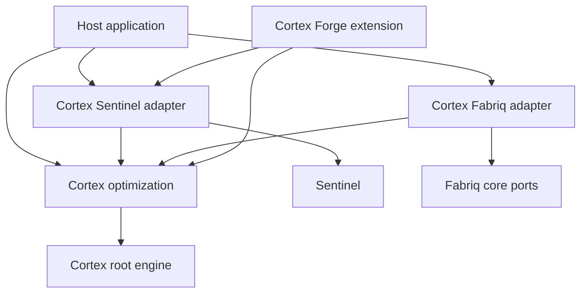

# Cortex optimization design

Status: proposed design for review. Ownership is approved; the detailed choices below are proposals. No implementation is authorized by this document.

Date: 2026-10-18

Implementation plan: [Phased implementation plan](../plans/2026-10-18-cortex-optimization.md)

## 1. What you can do

You can take an existing Cortex agent, freeze its operating configuration, and run a bounded experiment to improve how it handles a task or a collection of tasks. Cortex proposes changes and executes trials. Sentinel scores the captured outputs and compares the results. Fabriq supplies relevant lessons from earlier experiments and retains new lessons with their supporting evidence.

You review the configuration diff, the trials and the evaluation before activating a version. Activation changes which version future opt-in runs use. Runs already in progress keep their original snapshot, including across suspension and restart.

The first delivery supports offline experiments on a single agent. Later phases add parallel search, task-local refinement, improvement-controller versions and approved orchestration presets. All are part of this plan. Arbitrary generated scripts, executable plugins, model training and automatically changing production configuration are outside this delivery.

## 2. Ownership and module graph

The agreed ownership is Cortex for optimization and adoption, Sentinel for evaluation, and Fabriq for learning storage and retrieval.

| Component                                                  | Owns                                                                                                        | Does not own                                                   |
| ---------------------------------------------------------- | ----------------------------------------------------------------------------------------------------------- | -------------------------------------------------------------- |
| Cortex root engine                                         | Prepared execution, tools, authorization, sessions, traces, checkpoints and suspension                      | Experiment scheduling, evaluation suites or lesson search      |
| `github.com/xraph/cortex/optimization`                     | Harness versions, experiments, candidates, trials, budgets, evidence links, adoption and activation history | Sentinel scorer implementations or a second knowledge database |
| `github.com/xraph/sentinel`                                | Frozen evaluation inputs, recorded-output scoring, comparisons, regression evidence                         | Editing or activating Cortex agents                            |
| `github.com/xraph/cortex/sentinel/optimization`            | Scope mapping, trace conversion and the optimizer's evaluator adapter                                       | A second scoring engine                                        |
| `github.com/xraph/cortex/integrations/fabriq/optimization` | Lesson entity schema, guarded publication, filtered recall and provenance validation                        | Authoritative harness versions or activation state             |
| Cortex API and Forge extension                             | Authenticated commands, lifecycle wiring, dashboard contracts                                               | Unrestricted configuration editing by model output             |
| Host application                                           | Identity, policy, approved tools/environments, model providers and activation permission                    | Implicit trust in a candidate's claimed score                  |

`optimization/` is a new Go module. Its core package imports Cortex and small existing utilities. Its store packages reuse Grove and the corresponding drivers, following Cortex's backend conventions. It has no direct dependency on Sentinel, Fabriq, Forge or a model vendor SDK. Dependencies flow from the existing adapter modules into optimization, never back from optimization into those adapters. Cortex root never imports optimization.



The Forge extension accepts an explicitly constructed optimizer. It does not discover a lesson writer with ambient privileges or require Fabriq for every Cortex installation. An optimization capability is unavailable until the host supplies the store, trial environment factory, authorizer, identity resolver, evaluator and controller.

## 3. Source baseline and gaps

This inspection used Cortex `685e9ae9decf`, Sentinel `efbad75633a6`, Fabriq `5f58c8334ceb`, and forge-dashboard `edfac7f0a0e6`. These identify the inspected checkouts, not release requirements. Implementers must recheck the files before editing because these repositories have concurrent work.

| Existing source                                              | Reuse                                                                | Gap to close                                                                                                                        |
| ------------------------------------------------------------ | -------------------------------------------------------------------- | ----------------------------------------------------------------------------------------------------------------------------------- |
| `engine/react.go`, `engine/resume.go`, `suspension/`         | One ReAct loop for new and resumed execution                         | An immutable prepared execution path and durable optimization provenance                                                            |
| `engine/prompt.go`, `prompt/section.go`, `prompt/overlay.go` | Prompt producers, ordered sections and scoped overrides              | Resolve once, preserve source identity and enforce a separate optimization edit policy                                              |
| `engine/engine.go:RunOverrides`                              | Run settings and explicit session selection                          | Empty tool lists currently cannot express a per-run denial of all tools; prepared execution must preserve explicit empty allowlists |
| `scope.go`, store scope helpers                              | One to three ordered scope levels                                    | Optimization must validate exact resource scope and never use a fourth level as isolation                                           |
| `agent/clone.go`                                             | Independent configuration copies                                     | Cloning alone does not freeze referenced skills, persona, tools, knowledge or environment                                           |
| `plugin/`, `audit_hook/`, `observability/`                   | Lifecycle integration patterns                                       | Optimization events, durable transition audit and bounded metrics                                                                   |
| `sentinel/adapter.go`                                        | Run/step/tool trace conversion                                       | Current adapter starts an agent and does not populate cost; scoring captured trials requires a separate path                        |
| `sentinel/plugin.go`                                         | Completion hook registration                                         | Automatic evaluation is a TODO and must not recursively trigger itself                                                              |
| Sentinel `engine/runner.go`, `comparison/`, `baseline/`      | Scorers, results, side-by-side execution and baselines               | Recorded-input scoring, pinned suite/case/scorer definitions and comparisons without rerunning targets                              |
| `integrations/fabriq/plugin.go`, `memory.go`                 | Guarded memory writes and entity registration                        | Validated lesson records, explicit scope filters, reliable publication and recall eligibility                                       |
| Fabriq `core/agent/{write,recall}.go`                        | Expected-version writes, explicit aggregate IDs, filtered recall     | Prove the pinned release provides the required semantics; upstream regression coverage for guarded writes and filters               |
| `extension/contract/`, dashboard `packages/plugin-cortex`    | Cortex contributor, scope resolver, route host and command transport | Optimization capabilities, intents and compact review pages                                                                         |

Some agent fields are stored without runtime application on the current ReAct path, including behavior rules and cognitive phases. They cannot be advertised as effective optimization dimensions. The capability response lists only dimensions that the executor actually applies.

Google's [Harness² repository](https://github.com/google-research/harness2) describes task-level propose, probe and compose, followed by retained lessons that guide future refinement. Its [experiment guide](https://github.com/google-research/harness2/blob/main/docs/EXPERIMENTS.md) distinguishes parallel search from sequential refinement. This design adapts those ideas to Cortex's existing execution and authorization contracts. It is not a benchmark reproduction or a claim that Cortex will inherit the reported gains.

## 4. Delivery scope and chosen defaults

These are proposed defaults, not prior user requirements.

| Decision              | Initial rule                                                                                                  |
| --------------------- | ------------------------------------------------------------------------------------------------------------- |
| Enablement            | Explicit host opt-in; no optimizer on ordinary `RunAgent` calls                                               |
| Execution mode        | Offline sequential experiments first                                                                          |
| Search                | One general candidate and one domain candidate per round; at most one composed candidate                      |
| Limits                | Two rounds, six non-baseline candidates, 500 total trials, concurrency two, experiment deadline 30 minutes    |
| Per-trial limits      | Two minutes and 12 ReAct steps; provider output cap and aggregate usage reservation also required             |
| Repetitions           | Three per case and configuration for offline comparisons                                                      |
| Dataset split         | Host supplies distinct discovery and validation cases; duplicate content hashes across splits are rejected    |
| Adoption              | Record a recommendation; keep the baseline if no candidate clears the gate                                    |
| Activation            | Explicit authorized command with expected revision; automatic activation disabled                             |
| Model                 | Freeze the executor's resolved provider/model revision within an experiment                                   |
| Money                 | Integer USD micro-units for budgets; provider pricing revision and estimate/actual provenance required        |
| Lesson scope          | Exact Cortex scope, domain and compatible harness schema; no automatic cross-tenant sharing                   |
| Controller            | Frozen proposer/composer/reflector configuration per experiment                                               |
| Task-local refinement | Explicit API, isolated repeatable environment, maximum one round by default; never activates a global version |

Token and money budgets have no universal numeric default. The host must supply finite positive token and money limits for model-backed execution, or explicitly declare a token-only mode when it cannot account for money. Token-only mode cannot advertise an enforced monetary cap. Deterministic fixture controllers use zero-priced accounting explicitly, with a fixture label.

Preflight calculates the maximum scheduled trials and reserves capacity for final validation before discovery starts. Twenty validation cases with three repetitions for baseline and finalist need 120 trials. With ten discovery cases and all six proposed candidates, discovery needs at most 210 trials, so the default 500-trial cap can accommodate this example. Time, tokens and money can still stop it earlier; those outcomes remain incomplete.

Initial mutable dimensions are unlocked prompt section bodies, guidance for already registered tools, selection of approved tools, and instruction fragments from a host-approved skill catalog. Persona and trait content can be included as frozen sources, but identity or authorization policy sections remain immutable. Sampling settings may vary only within host bounds. Changing models is a separate experiment with a new baseline, not a hidden candidate edit.

Later phases allow choosing from approved orchestration presets and editing declared delegation instructions. They do not generate executable plugins, alter tool schemas or implementations, or create arbitrary agent graphs. Such changes require a separate design.

## 5. Public contracts and data ownership

All names in this section are proposed APIs. Existing APIs named in section 3 remain as they are unless a task explicitly changes them.

The concurrent local draft `docs/superpowers/specs/2026-10-18-cortex-assured-execution-design.md` proposes some of the same foundations. Before implementation, reconcile prepared execution, outcome/stop reasons, provenance, recorded evaluation, environment receipts and lesson envelopes with that workstream. Root execution contracts have one runtime owner, generic recorded scoring has one Sentinel owner, and lesson storage contracts have one Fabriq adapter owner. Consume an existing compatible implementation instead of adding a parallel API. This dependency does not require the entire assured-execution roadmap to ship first.

### 5.1 Root execution contract

Add `engine/prepared.go`, `engine/prepared_run.go` and `engine/execution_context.go` in the root module. They contain engine concepts only.

```go
func (e *Engine) PrepareAgent(ctx context.Context, agentID id.AgentID, overrides *RunOverrides) (*PreparedAgent, error)
func (e *Engine) RunPrepared(ctx context.Context, prepared *PreparedAgent, input string, opts PreparedRunOptions) (*run.Run, error)

type PreparedRunOptions struct {
    SessionID id.SessionID
    Provenance ExecutionProvenance
}
```

`PreparedAgent` contains schema version, original agent ID, exact scope, fully resolved ordered prompt sections, resolved model settings, explicit tool allowlist, frozen tool schemas/descriptions and implementation revision references, source references, knowledge snapshot references and a content digest. It carries the resolved safety profile reference; the host can tighten current policy but a candidate cannot weaken it. No credentials, live function pointers or mutable store references are serialized.

`ExecutionProvenance` contains purpose (`normal`, `optimization_trial`, `evaluation` or `optimization_controller`), experiment/candidate/trial IDs as strings, prepared digest, environment receipt ID and parent execution ID. It is trusted host input, not model input. Store it in run metadata and in suspension continuation. Existing runs with no provenance remain readable as ordinary runs. The tags are routing information and confer no permission.

Preparation uses the existing section producers and config merge. It resolves references once and captures retrieval failures explicitly. Required knowledge unavailable means preparation fails; optional knowledge records a missing-input marker shared by every candidate. A source change during preparation is detected through revision checks before and after collection and returns a conflict. Providers without stable revisions need a host snapshot implementation or the experiment cannot claim reproducible inputs.

Prepared execution uses the same ReAct loop. It skips live re-resolution of persona, skill, trait and overlay records, but still authorizes every tool call against the current host policy. Tool revision mismatch, missing implementation or lost permission is an execution error. It does not silently select a replacement tool. Resume uses the saved prepared state and current authorization, never the latest activation.

Captured execution records must distinguish an actual final answer from step exhaustion, timeout, cancellation, suspension and policy refusal. A legacy `completed` state alone is insufficient evidence of successful completion. Share the additive outcome/stop-reason contract with the runtime workstream; unknown historical outcomes stay unknown and cannot qualify as successful validation trials.

The optimizer must never mutate the shared `Engine`, register a temporary global tool, or temporarily edit an agent/overlay to run a candidate. A host-created isolated engine binds the prepared configuration to approved tool implementations. This also prevents two simultaneous experiments from changing one another's inputs.

### 5.2 Optimization types

Use Cortex `id.ID` and `id.New` with module-owned prefixes: `harn` (harness), `hrev` (version), `oexp` (experiment), `ocan` (candidate), `otrl` (trial), `odec` (decision), `oles` (lesson), `oevt` (event), `oact` (activation) and `oatt` (attempt). Parser functions check prefixes. These constants live in `optimization/ids.go`; no root ID changes are needed.

| Record                 | Required content and invariant                                                                                                                                                                                                                                 |
| ---------------------- | -------------------------------------------------------------------------------------------------------------------------------------------------------------------------------------------------------------------------------------------------------------- |
| `Harness`              | ID, exact scope, agent ID, name, kind (`execution` or `improvement`), creation identity; mutable display metadata has revision control                                                                                                                         |
| `HarnessVersion`       | Harness ID, parent version, schema version, content digest, prepared agent or controller spec, policy digest, source revisions and creator; content is immutable                                                                                               |
| `Experiment`           | Baseline version, mode, frozen task set, objective, policy, controller version, budget, lesson cutoff, state, revision and requester identity reference                                                                                                        |
| `TaskCase`             | Stable case ID, input, environment snapshot reference, context references, split and content digest; private evaluation fields are kept outside controller input                                                                                               |
| `ValidationAllocation` | Exact scope, agent ID, normalized case/input hashes, dataset item/revision references, assigned experiment, optional frozen paired-arm/child roster and exposure state; consumed cases cannot be allocated outside that ownership for the same scope and agent |
| `Candidate`            | Experiment, parent candidates, general/domain/composed origin, structured patch, predicted effects, supporting evidence IDs, validation result and version ID                                                                                                  |
| `Trial`                | Candidate or baseline, case, repetition, environment receipt, execution IDs, attempt history, prepared digest, outcome, usage, artifact references and evaluation reference                                                                                    |
| `Evaluation`           | External evaluation ID, frozen plan digest, captured execution digest, scorer versions, per-criterion values, completeness, errors and trusted timestamps                                                                                                      |
| `Decision`             | Compared versions, exact evidence IDs, selection kind, criteria, deltas, outcome (`recommend`, `retain`, `inconclusive`, `reject`) and reasons                                                                                                                 |
| `Activation`           | Exact scope + agent + channel, version, generation, expected prior generation, actor, policy digest and decision ID; channel defaults to `default`                                                                                                             |
| `Lesson`               | ID, scope, domain, statement, applicability, contraindications, source decisions/trials, evidence quality, expiry and revocation state                                                                                                                         |
| `Event`                | Monotonic sequence per experiment, event ID, type, time, actor, referenced resources and redacted payload                                                                                                                                                      |
| `Reservation`          | Call key, attempt, operation class, token/money upper bound, lease and settlement state                                                                                                                                                                        |
| `Publication`          | Lesson ID, operation (`publish` or `revoke`), immutable payload digest, local revision, remote aggregate ID/version, attempts, next retry and terminal error                                                                                                   |

Store full configuration content in the optimization database. Store large traces/artifacts through an injected `ArtifactStore`, referenced by digest and access policy. A built-in database artifact adapter supports small deployments; an object-store adapter can be supplied by the host. Never place secrets or unrestricted tool output in metric labels, event summaries or Fabriq lesson text.

### 5.3 Service and ports

Use `New(opts ...Option) (*Optimizer, error)` with `Option func(*Optimizer) error`. Constructors validate required dependencies. These signatures form the implementation seams:

```go
func (o *Optimizer) Create(ctx context.Context, spec ExperimentSpec) (*Experiment, error)
func (o *Optimizer) Start(ctx context.Context, experimentID id.ID, expectedRevision int64) (*Experiment, error)
func (o *Optimizer) Get(ctx context.Context, experimentID id.ID) (*Experiment, error)
func (o *Optimizer) List(ctx context.Context, query ListQuery) (Page[Experiment], error)
func (o *Optimizer) Cancel(ctx context.Context, experimentID id.ID, expectedRevision int64) (*Experiment, error)
func (o *Optimizer) Resume(ctx context.Context, experimentID id.ID, expectedRevision int64) (*Experiment, error)
func (o *Optimizer) Activate(ctx context.Context, req ActivationRequest) (*Activation, error)
func (o *Optimizer) Rollback(ctx context.Context, req RollbackRequest) (*Activation, error)
func (o *Optimizer) OptimizeTask(ctx context.Context, spec TaskSpec) (*TaskResult, error)
func (o *Optimizer) RunActive(ctx context.Context, req ActiveRunRequest) (*run.Run, error)
func (o *Optimizer) Work(ctx context.Context) error
```

`Create` validates and persists an immutable experiment specification plus a draft event. `Start` queues it and returns promptly. `Work` claims durable work and executes phases; it is started by the host lifecycle. `OptimizeTask` creates a task-local experiment, waits under the caller deadline, and returns the chosen completed trial output and evidence without executing that task again. Its signature does not imply global activation. `RunActive` resolves the activation once and executes its immutable version, failing explicitly if the host has not configured an active version.

```go
type Controller interface {
    Propose(context.Context, ProposalInput) ([]Proposal, error)
    Compose(context.Context, CompositionInput) (Proposal, error)
    Reflect(context.Context, ReflectionInput) ([]LessonDraft, error)
}
type Evaluator interface {
    Freeze(context.Context, EvaluationSpec) (EvaluationPlan, error)
    Evaluate(context.Context, EvaluationRequest) (Evaluation, error)
    Compare(context.Context, ComparisonRequest) (Comparison, error)
}
type EnvironmentFactory interface {
    Open(context.Context, TrialRequest) (TrialEnvironment, error)
    Recover(context.Context, EnvironmentReceipt) (TrialEnvironment, error)
    Stop(context.Context, EnvironmentReceipt, Fence) (StopReceipt, error)
}
type TrialEnvironment interface {
    Receipt() EnvironmentReceipt
    Execute(context.Context, *engine.PreparedAgent, string, engine.PreparedRunOptions) (*ExecutionRecord, error)
    Inspect(context.Context, id.ID) (AttemptStatus, error)
    Close(context.Context) error
}
type LessonStore interface {
    Publish(context.Context, Lesson) (PublicationReceipt, error)
    Recall(context.Context, RecallQuery) (LessonPage, error)
    Revoke(context.Context, id.ID, int64) error
}
type Authorizer interface {
    Authorize(context.Context, Action, Resource) error
}
type IdentityResolver interface {
    Resolve(context.Context, IdentityRef, cortex.Scope) (context.Context, error)
}
type ArtifactStore interface {
    Put(context.Context, Artifact) (ArtifactRef, error)
    Get(context.Context, ArtifactRef) (Artifact, error)
    Delete(context.Context, ArtifactRef) error
}
```

Inputs are versioned JSON DTOs defined in `types.go`, `controller.go`, `evaluation.go`, `environment.go`, `lessons.go` and `artifacts.go`. `ExperimentSpec` carries the records listed above by immutable reference or by value. `Proposal` is an allowlisted patch plus rationale and evidence IDs, never a complete host configuration. `ExecutionRecord` contains original run/step/tool IDs, outcome, output, timing, usage quality, environment receipt and trace/artifact digests. `EvaluationRequest` includes that captured record and the frozen evaluation plan. `ComparisonRequest` includes ordered baseline/candidate evaluation IDs and the objective. `Comparison` contains per-case paired deltas, criterion outcomes and missing-data reasons.

`IdentityRef` is a host-owned stable subject reference, not a serialized interface or bearer token. A worker resolves current grants before a phase or retry. `ActiveRunRequest` contains agent ID, channel, input and caller session choice; active execution uses the explicitly bound production engine and its current host tool policies, never a trial tool registry.

`EnvironmentReceipt` contains provider/environment IDs, attempt ID, snapshot digest, isolation capabilities and fencing generation. `Open` is idempotent by attempt ID and returns the same durable environment after an ambiguous provisioning response. Persist the receipt before `Execute`. `Recover` reconnects to that exact environment after process loss. `Stop` requests fenced cancellation and returns confirmed termination, confirmed quarantine, or unknown; only the first two permit safe replacement. `Close` releases a client handle and does not stand in for remote termination. Providers unable to recover or stop work cannot advertise durable optimization readiness.

## 6. Harness edits and reproducibility

Each version records canonical JSON with a schema version and SHA-256 digest. Exclude database timestamps and display metadata from the content digest. Preserve section order and explicit empty collections. Reject unknown JSON fields, duplicate section IDs, non-finite sampling values, oversized bodies and references outside the frozen approved catalog.

`EditPolicy` identifies mutable section IDs, tool selections, instruction fragments, numeric bounds and maximum diff size. Locking a prompt section is insufficient: current per-run overrides can replace stored sections. Optimization validation therefore compares every candidate against the frozen base and host policy, and prepared execution repeats the policy check before scheduling a trial.

Host policy fixes scope, credentials, authorization, safety scanners, allowed tool implementations, filesystem/network limits, evaluator definitions, audit sinks and budget ceilings. It may tighten between trials. Tightening invalidates affected trials and requires a new decision. Candidates cannot edit any of those controls.

Snapshot the model's resolved identifier, provider revision where supplied, prompt content, tool definitions and revisions, retrieval corpus or fixture revision, environment image, policy version, source code revision and controller configuration. A model alias that cannot be pinned is recorded as unstable; comparisons can still be exploratory but cannot pass a reproducibility-required activation policy. Seeds describe sampling requests only, never a promise of deterministic model output.

## 7. Experiment lifecycle and recovery

Experiment states are `draft`, `queued`, `running`, `paused`, `review_required`, `completed`, `cancelled`, `failed` and `budget_exhausted`. `running` has a persisted phase: `baseline`, `propose`, `probe`, `compose`, `validate`, `decide`, `reflect`. Only the worker with the current lease generation can advance a phase. Every transition, usage settlement and audit event commits atomically in the optimization store.

`review_required` means a recommendation is available; it does not mean a version is active. An activation or explicit retain decision closes review as `completed`. A completed task-local experiment needs no activation. A budget stop retains partial evidence and cannot be rendered as a successful comparison.

Trials have `queued`, `running`, `completed`, `failed`, `cancelled`, `blocked`, `unknown` and `invalidated` states. A crash after an external call starts but before its result is persisted becomes `unknown`. On recovery, call `Inspect` with the attempt ID; if no authoritative result can be recovered, do not silently rerun a side-effecting attempt. The operator can authorize a new attempt only if the environment declares it resettable or supplies an idempotency guarantee. Preserve both attempts.

Use a 30-second work lease with a heartbeat every 10 seconds, configurable within host limits. Store fencing generations with writes. A replacement worker must first confirm the old environment has terminated or is quarantined before retrying an unknown attempt. Store leases prevent duplicate persistence; the environment contract is responsible for preventing duplicate external effects.

No transaction spans a model call. A phase reserves usage, writes its attempt, performs the call, stores artifacts, then settles the result. Artifact writes are content-addressed and may be retried. Orphan artifacts are collected after a grace period; missing required artifacts make the evaluation incomplete.

Cancellation stops new reservations immediately, cancels active contexts, asks each environment to stop and records any unsettled call as unknown usage. Shutdown drains or relinquishes work without declaring it complete. Resuming uses the original specification and cutoff, with revalidated current permissions. A changed policy or unavailable frozen dependency requires a new experiment, not an implicit rebase.

## 8. Search and selection

### Offline sequential mode

1. Freeze the task set, evaluation plan, environment state, controller version and recalled lessons before starting the baseline.
2. Execute baseline trials on discovery cases with the prescribed repetitions.
3. Ask the controller for a general candidate and a domain candidate. Each includes a predicted effect and references the baseline evidence it used.
4. Validate and deduplicate patches. Rejected or duplicate candidates still consume controller usage and leave a reason in history, but do not consume trial slots.
5. Probe valid candidates on the same discovery cases, repetitions and initial environment snapshots. Keep model version and scoring fixed.
6. Compose at most one new candidate from the behavioral contrasts. A composition is a new version and must be executed; it cannot inherit its parents' scores.
7. Select a discovery finalist. In the next sequential round it becomes the base only if it clears discovery gates; otherwise carry the current incumbent forward.
8. After the last round, run the original baseline and finalist on the untouched validation cases. Validation outcomes are withheld from the controller until the experiment has ended.
9. Record recommend, retain, reject or inconclusive. Reflect on eligible discovery evidence and queue lessons for publication. Validation answers and rubrics never become searchable lesson content.

Parallel mode keeps the same fixed baseline and explores candidate proposals concurrently within one round. Composition waits for all scheduled probes or explicit terminal statuses. Order results by stable trial IDs before constructing the controller input, so completion timing cannot change which evidence is included. Sequential and parallel modes share the same total budget and data model.

### Task-local mode

Task-local refinement has no expected answer requirement. The controller compares captured execution behavior and may use Sentinel criteria that do not require ground truth. This evidence is labelled `contrastive`, not verified correctness. The selected completed trial supplies the user-facing result. Re-executing it would be a new attempt with different effects and evidence.

Only repeatable isolated environments support this mode. Read-only responses and sandbox artifacts can be adopted; any command affecting a live system remains outside automatic task-local selection. Exporting sandbox artifacts uses a host-controlled commit action with its own authorization. Ordinary production tool calls are not automatically repeated to find a better answer.

Task-local success does not qualify a version for global activation. You need a separate offline validation experiment for that.

### Objective and adoption policy

The default primary objective is mean paired quality score improvement, candidate minus baseline, at least `0.02` on a 0-to-1 scale. Required safety/format criteria must pass independently; they cannot be hidden by an average. Default maximum regression for any named protected quality dimension is `0.01`. Cost and latency are separate constraints set by the host. A cost objective is unavailable when usage or pricing is unknown.

For offline activation recommendations, use at least 20 distinct validation cases, each with three paired repetitions. Average repetitions per case, then calculate a deterministic paired bootstrap confidence interval over case means with 2,000 resamples and a stored seed. Require a 95% lower bound greater than zero in addition to the minimum mean improvement. Smaller suites produce exploratory evidence and an `inconclusive` activation recommendation. Sentinel owns the statistical calculation; Cortex owns the policy that interprets it. This is a selection policy, not a claim of universal statistical sufficiency.

Scorer errors, missing required trials, changed evaluation definitions or unavailable required artifacts yield `inconclusive`, never zero scores. Among candidates that satisfy hard constraints, choose quality first, lower known cost second, lower latency third, then digest order for deterministic ties. Keep the baseline when no candidate qualifies.

The improvement controller cannot edit scorer definitions, dataset splits, thresholds or private expected outputs. Discovery score feedback can inform proposals. Holdout validation is consumed once at the end; a failed validation requires a new experiment and a fresh holdout allocation before further tuning can count as independent validation.

The optimization store owns validation allocations. `AllocateValidation(ctx context.Context, req ValidationAllocationRequest) (*ValidationAllocation, error)` atomically binds case identities and normalized input hashes to one experiment under exact scope and agent. It refuses hashes already exposed by another experiment, regardless of harness ID, name or task-family label. Mark the allocation exposed before the first validation call. Retries for the same frozen baseline/finalist may resume within that experiment; replacing the finalist requires another allocation. A reservation can be released only if no validation work was dispatched. This guarantees non-reuse within this optimizer's records; the host remains responsible for declaring whether imported cases were exposed outside the system.

Controller comparisons use one parent-owned paired allocation. Before dispatch, freeze both controller versions and the permitted arm/child experiment roster in that allocation. Both arms may consume its paired cases; unrelated children, replacement arms and later tuning cannot. Each child freezes its selected execution harness before evaluating that child's held-out cases. Validation results and reflections remain withheld from both arms until the whole paired evaluation finishes. Resuming the exact roster is allowed; replacing it requires a fresh allocation. Discovery tasks may teach later discovery tasks within each arm, but validation tasks cannot feed subsequent tuning. Store conformance tests enforce this exception explicitly rather than bypassing allocation checks for child experiments.

## 9. Budget accounting and trial isolation

The ledger covers baseline runs, proposals, probes, compositions, validation, reflection, model judges, embeddings and any metered retrieval/tool operations. Every call gets a durable reservation key. Concurrent reservations must fit within the remaining budget before a call starts.

`Meter` supplies `Reserve(ctx, UsageReservation) (Reservation, error)` and `Settle(ctx, UsageSettlement) error`. The store implements both atomically. A model wrapper obtains a conservative token upper bound from the actual request and output cap, prices it using the frozen pricing revision, and reserves before calling. Unknown token accounting or unbounded tool charges are rejected under strict enforcement. Provider usage settles once; duplicate receipts are idempotent. Timeout without a receipt retains the upper-bound debit until reconciled. Observed overrun is recorded and stops new calls, rather than being clamped out of the ledger.

`CallMeter` extends that port with `BeginCall(ctx, UsageReservation, requestDigest) (Reservation, error)`. The call boundary commits the reservation and one dispatch marker together before invoking the provider. A reservation retry alone cannot authorize another invocation. The marker binds the actual frozen request digest and current worker lease; an identical repeat requires reconciliation, while changed content under the same key conflicts. The host adapter computes the digest and establishes receipt provenance. Cancellation or a lost acknowledgment after commit retains the debit and marker.

`MeteredClient` implements the existing `llm.Client` port for synchronous and
streaming calls. Its configuration freezes exact scope, experiment, attempt,
operation, model and model revision, plus accepted request and response JSON
limits. It passes a detached actual request to `UsageEstimator`, binds the full
request and streaming mode to the dispatch digest, and verifies returned dispatch
authority before calling the provider. Provider routing must be pinned by the
host; a configured model name cannot establish that pin.

`ModelUsageReporter.Observe(ctx, ModelObservation) (ModelUsageReport, error)`
establishes receipt provenance and frozen prices. Execution completion and
accounting completeness are separate facts. Raw `llm.Usage` cannot prove that
reporting is complete, so absent a valid authoritative report the ledger retains
the upper bound and records observed overruns. Streaming cancellation closes the
source, captures usage available during close and settles once. Only clean
iteration and settlement return EOF. Accounting failures must not wrap EOF,
because the existing engine tests that sentinel before other errors.

Each trial receives a fresh session, a reset copy of its environment snapshot, frozen retrieval inputs and an allowlisted tool registry. Use host-provided containers, virtual machines or equivalent isolation where tools touch files, networks or processes. A new database scope or session is not a sandbox. Keep the existing one-to-three-level Cortex scope intact and attach experiment identity separately.

The optimizer validates scope structure, exact agent scope, unique level keys and forbidden canonical separators before creating records. Workers and adapters never manufacture a missing scope. A required host mapper converts that scope to Sentinel app/tenant and Fabriq tenant/filter context. Empty, malformed, conflicting or unauthorized mappings fail before any external read or write. Cross-scope list access is explicit authorization; exact resource mutations never rely on ancestor prefix matching alone.

Trial execution is excluded from ordinary learning hooks, notifications and unscoped analytics. The Fabriq run-memory plugin skips `optimization_trial`, `evaluation` and `optimization_controller` purposes. Only the explicit reflection pipeline may publish optimization lessons. A trial requesting approval or external tool suspension becomes `blocked` unless the environment has a registered deterministic responder. It must not create a production approval request accidentally.

## 10. Sentinel changes

Add generic APIs in Sentinel, with no Cortex import:

```go
func (e *Engine) FreezeEvaluation(ctx context.Context, req FreezeRequest) (*EvaluationPlan, error)
func (e *Engine) EvaluateRecorded(ctx context.Context, req RecordedRunRequest) (*RunResult, error)
func (e *Engine) EnqueueRecorded(ctx context.Context, req RecordedRunRequest) (*RecordedJob, error)
func (e *Engine) WorkRecorded(ctx context.Context) error
func CompareRecorded(ctx context.Context, req RecordedComparisonRequest) (*RecordedComparison, error)
```

`FreezeRequest` names suite, exact cases, scorer configurations/versions and criteria. The returned plan contains immutable case snapshots, prompt/evaluator settings, digest and provenance. Scorers supplied as functions require a host-provided revision ID. The plan records which criteria require expected answers, so task-local mode can reject incompatible criteria before execution.

`RecordedRunRequest` contains plan ID/digest, idempotency key, source experiment/candidate IDs, and one `RecordedCase` per case/repetition. Each case contains captured output, trace, execution outcome, original duration, token/money usage with known/estimated flags, input digest and artifact references. It has no target callback. The code reuses the runner's scoring function, result persistence, hooks and reporting, preserving execution errors separately from scorer errors. Scoring latency and judge cost are recorded separately from the agent's original latency and cost.

`CompareRecorded` accepts immutable completed evaluation references, validates matching plan/case/repetition identities, and returns paired deltas, criterion failures, confidence interval and incompleteness reasons. It never calls `Target.Call`. Existing `RunEval` and `comparison.Compare` retain their public behavior.

Persist frozen plans and recorded-run provenance across memory, SQLite, Postgres and Mongo backends. Add usage-quality fields without interpreting historical zero cost as known free execution. Historical rows have `unknown` quality unless provenance establishes otherwise. Do not change the meaning of old score fields.

Sentinel also owns durable recorded-evaluation jobs: immutable request references, idempotency keys, lease generations, bounded retries and terminal status. `EnqueueRecorded` persists before acknowledging; `WorkRecorded` scores captured inputs and never invokes a target. A duplicate key with different request content is a conflict. Production readiness requires a persistent backend; memory supports tests only. Host lifecycle explicitly starts the worker. This queue is generic Sentinel infrastructure and has no dependency on optimization storage.

In Cortex's Sentinel adapter, expose explicit scope mapping and convert captured Cortex execution records. The current `AgentClient.Run` remains supported for ordinary suite execution. The optional completion evaluator enqueues into Sentinel using a frozen evaluation binding. Its idempotency key includes exact source scope, source run ID and binding digest. A host-scheduled reconciler scans persisted completed Cortex runs for each explicit binding and repeats enqueue safely, covering a crash before the completion hook delivered its notification. A per-binding durable source cursor lives with Sentinel's recorded-job store and advances only after enqueue acknowledgment; use stable completion-time/run-ID ordering with overlap to cover delayed persistence. Suppress evaluation-purpose runs and optimizer-owned trials to avoid feedback loops. If no suite binding, persistent queue or worker exists, report unconfigured. Do not guess a suite from an agent name.

The optimizer's recorded evaluation path does not depend on enabling automatic evaluation globally. Both reuse the same conversion and scoring primitives.

## 11. Fabriq changes and learning lifecycle

The required product work lives in Cortex's existing Fabriq integration module. Fabriq remains a general data fabric. Add an optimization lesson entity spec and a typed adapter over `agent.Toolkit.Remember` and `Recall`; do not put Cortex domain types in Fabriq core.

The entity has indexed columns for exact scope key, domain, harness schema, evidence class, active flag, expiry, source experiment ID and publication digest, plus lesson content and structured provenance. Register its schema and provision its physical table through a host migration before workers start. The existing `MemorySpec` explicitly does not create a table, so capability readiness must verify schema provisioning, write policy and retrieval availability.

Use a stable publication aggregate ID recorded before the first write. Create with explicit ID and expected version zero; on an ambiguous result, read the authoritative row and compare the immutable payload digest. The same digest means the write already succeeded; a different digest is a conflict. Do not use blind upsert as an exactly-once claim: repeated upserts can emit new events and advance versions. Revocation uses expected-version update and retries only after an authoritative read.

The optimization database owns a publication outbox committed with each accepted lesson. A publisher retries with bounded exponential backoff and records pending, published or failed status. A Fabriq outage does not erase experiment results or activate a configuration. Explicit retry is available to an authorized operator. Lesson publication failures are visible in the dashboard.

Recall filters by authorized exact scope, domain, active status, expiry and compatible schema before content reaches the controller. Freeze eligible lesson IDs and digests at experiment start, so a parallel experiment cannot teach another experiment halfway through its comparison. Reject lessons whose cited evidence is missing, revoked or not authorized. Evidence class distinguishes validated improvement, exploratory observation and failed approach. Contradictory lessons are returned with their conditions and evidence, not silently merged into a certainty.

Revoke a lesson locally first, in a transaction that advances its eligibility revision and queues a `revoke` publication. The local registry keeps IDs, digests and eligibility metadata; Fabriq remains the searchable lesson content store. Recall checks local eligibility even while a remote index is stale. Workers recheck frozen lesson eligibility before each phase and before activation. Revocation invalidates experiments and unactivated recommendations that used the lesson; running work is cancelled and the experiment becomes `paused` with reason `lesson_revoked`. Resuming requires a new experiment without that lesson. An active version becomes stale and blocks new `RunActive` calls until revalidated; in-flight runs keep their snapshot and current authorization. Remote revocation retries until acknowledged, and the dashboard exposes propagation failure. A later publish retry cannot overwrite a newer revocation.

Fabriq's current source provides filters, explicit aggregate IDs and expected versions. The integration currently pins `fabriq/core v1.7.1`, so task 12 must prove those operations against the pinned version and current root adapter. Add general Fabriq regression tests for create-with-explicit-ID retry behavior, expected-version conflicts, filter enforcement after hydration and deleted/revoked rows. If those tests reveal missing guarantees, fix the generic command/recall behavior upstream and release it before repinning Cortex. A new optimizer-specific Fabriq API is not required by this design.

Across tasks, the improvement harness consists of a versioned controller specification and an eligible lesson set. Reflection can propose a new improvement-harness version, but the active experiment's controller remains frozen. Evaluating a new controller is a separate offline experiment over a task stream with its own holdout. Limit this delivery to one meta level; an improvement experiment cannot recursively create another improvement experiment.

## 12. Persistence, activation and operational controls

Optimization owns its store interface and migrations. It does not expand root `store.Store` with optimizer-only methods. Ship memory for tests and PostgreSQL, SQLite and Mongo for production parity. All backends run the same populated conformance suite.

The store contract groups operations by atomic boundary: create experiment plus frozen references; claim/renew work with fencing; commit phase result plus event; reserve/settle usage; create decision plus lesson-publication rows; and compare-and-swap activation plus audit. Use unique keys for scope/idempotency key, experiment/candidate digest, candidate/case/repetition/attempt, and publication digest. Pagination is cursor-based on `(created_at, id)`; list filters use exact scope by default.

Activation is a separate record keyed by exact scope, agent and channel. It never overwrites the agent's editable configuration or a shared overlay. `RunActive` is the explicit execution path that honors it. The dashboard shows whether the host has wired that path; a stored activation without a consuming path is reported as inactive integration.

`optimization.WithActiveEngine(*engine.Engine)` supplies the trusted production engine for `RunActive`. It calls that engine's `RunPrepared` after resolving and checking the active snapshot. It never obtains production tools from `EnvironmentFactory`, which serves trials only. The `active_execution` capability stays unavailable without this binding and compatible production tool revisions. Trial and production engines may share stateless providers, but their tool registries and execution policies are explicitly bound by the host.

Activation requires a `recommend` decision with validated offline evidence for the exact version digest, agent, scope, objective, policy and validation allocation. A complete but failed, exploratory, task-local or inconclusive evaluation is ineligible. There is no force-activation override in this delivery. Activation rechecks current grants, source compatibility, lesson eligibility, evidence retention, policy digest and expected activation generation in one service operation. The store atomically changes the pointer and writes an event. Concurrent reviewers receive a conflict. Rollback creates a new activation generation pointing to a previously activated immutable version and its qualifying decision; it never rewinds history. The old evidence must still be retained and valid under current policy. A stricter policy can prevent rollback. A host may deactivate the optimizer route and use its normal agent execution path without pretending that an ineligible version passed validation.

Host edits to the underlying agent, tools or scope policy mark an activation stale when their revision differs from its compatibility fingerprint. New active runs fail with an actionable stale-version error until you revalidate or explicitly deactivate the activation. In-flight runs retain their snapshot and still obey current call authorization.

Retention defaults: keep experiment metadata, decisions and activation history indefinitely; keep raw trial artifacts for 30 days, configurable by the host. Do not delete evidence backing an active version without first marking its validation expired and blocking new activation from it. Deletion requests revoke dependent lessons and invalidate evidence references, with explicit partial-failure tracking across systems. Export requires read and artifact permissions and emits redacted content by default.

Audit records cover start, cancel, resume, denied commands, budget changes, decisions, activation, rollback, lesson publication/revocation and artifact export. Optimization's durable event log is the authoritative transition record; existing audit hooks may forward it to Chronicle or another sink. Metrics include phase duration, trials by outcome, reserved/settled usage, evaluation errors and publication lag. Keep IDs, prompts and tenant values out of unbounded metric labels.

## 13. API and dashboard integration

### Contracts and permissions

Extend the existing `cortex` contributor and `@cortex` namespace. Add `optimization *optimization.Optimizer` as an optional dependency and a host-supplied authorized evaluation catalog resolver. The frontend remains on `useQuery` and `useCommand`; it does not call Sentinel or Fabriq through another plugin's client.

New permissions are `cortex.optimization.read`, `cortex.optimization.manage`, `cortex.optimization.run`, `cortex.optimization.activate` and `cortex.optimization.artifacts`. Existing `cortex.manage` does not silently grant activation. Backend checks are mandatory even when a button is hidden.

All command DTOs include an idempotency key through the transport and an expected revision where the record is mutable. REST callers supply `Idempotency-Key`; dashboard callers use the existing command envelope. List inputs use `cursor` and `limit` (default 25, maximum 100); outputs use `items`, `next_cursor` and `complete`. Do not add invented totals to cursor lists.

| Query intent                               | Response purpose                                                                                     |
| ------------------------------------------ | ---------------------------------------------------------------------------------------------------- |
| `optimization.capabilities`                | Availability, permissions, editable dimensions, environments, scope mapping and accounting readiness |
| `optimization.catalog`                     | Authorized agents, frozen evaluation-plan choices, controllers and environment presets               |
| `optimization.experiments.list`, `.detail` | Experiment list and phase/budget/review summary                                                      |
| `optimization.candidates.list`, `.detail`  | Candidate lineage, patch and validation failures                                                     |
| `optimization.trials.list`, `.detail`      | Attempts, outputs, traces, usage quality and environment receipts                                    |
| `optimization.comparison`                  | Paired evidence, criterion outcomes, incomplete reasons and recommendation                           |
| `optimization.versions.list`, `.detail`    | Immutable execution/improvement versions and compatibility status                                    |
| `optimization.activations.list`            | Current generations and history                                                                      |
| `optimization.lessons.list`                | Provenance, expiry, revocation and publication state                                                 |
| `optimization.events.list`                 | Durable event cursor, including after reconnect                                                      |

| Command intent                                                  | Permission | Invalidated query families                               |
| --------------------------------------------------------------- | ---------- | -------------------------------------------------------- |
| `optimization.experiments.create`                               | manage     | experiments                                              |
| `optimization.experiments.start`, `.cancel`, `.resume`          | run        | experiments, trials, comparison, events                  |
| `optimization.decisions.retain`                                 | manage     | experiments, comparison, events                          |
| `optimization.activations.activate`, `.rollback`, `.deactivate` | activate   | activations, versions, experiments, capabilities, events |
| `optimization.lessons.retry`                                   | manage     | lessons, capabilities, events                            |
| `optimization.lessons.revoke`                                  | manage     | lessons, capabilities, experiments, comparison, events   |
| `optimization.artifacts.export`                                 | artifacts  | events                                                   |

Revocation pauses experiments that consume the lesson, so its invalidations also refresh experiment state and comparison revisions. A successful command confirms local withdrawal and a queued remote revocation, not completed remote delivery.

The implementation expands query families into exact intent names in `manifest.yaml` and tests the invalidation sets. Add matching REST routes under the API module's `/optimization` group with the same service DTOs and authorization. Missing optimizer returns unavailable; a configured optimizer with no experiments returns an empty list. Unauthorized resource IDs never reveal whether another scope owns the resource.

Capability reads accept an optional `experiment_id`. Without it, you get scope
setup diagnostics. With it, the service checks prerequisites for that frozen
experiment and derives editable dimensions from its saved policy. The response
keeps `checks`, `permissions`, pricing quality and `trials_ready` separate.
`trials_ready` does not override lifecycle, budget or command authorization.
Dashboard permissions also require the signed-in user's matching optimization
scope. An unavailable host probe leaves readiness unavailable, not an empty
successful result. Every request probes again; restarting the host cannot restore
an earlier readiness observation.

### Pages and interaction

Add one Optimization nav item under Cortex. Routes are scope-relative inside the plugin:

- `/optimization`: compact summary row, pending review alert, filters and experiments table.
- `/optimization/new`: agent, objective, task split, environment, controller and budget form. Preflight shows expected trial count and missing dependencies before Start.
- `/optimization/:id`: phase progress and usage on one row, tabs for Candidates, Trials, Comparison, Lessons and History.
- `/optimization/:id/candidates/:candidateId`: configuration diff beside evidence; inherited immutable settings stay visible.
- `/optimization/:id/trials/:trialId`: original Cortex run link, output, tool trace, environment receipt and scoring failures.
- `/optimization/versions/:versionId`: immutable version, source revisions, activation history and compatibility.

Use existing kit `ResourceTable`, `QueryBoundary`, `ConfirmDialog`, shared density variants and `ZeroState`. Empty results use the left-aligned illustrated treatment with explanation and action inside it. Loading, denied access, missing integration, failed request and an incomplete search have separate rendering. Show unknown cost as unknown, exploratory evidence as exploratory, and no qualifying candidate as retained baseline.

Activation opens a compact review dialog with exact scope, version diff, validation evidence, source compatibility and expected generation. Errors stay inside the open dialog, and pending state prevents duplicate clicks. Rollback previews the target version and current policy check. Permission denial, stale generation and stale source revisions have distinct messages.

Use the existing shared `usePoll` helper with query refetch while an experiment is active, with durable event cursor recovery and server revision metadata. Preserve its page-visibility behavior. Commands use declared invalidation. Do not introduce component-local refresh machinery. Heavy diff/chart components are route-lazy. Cross-extension links use host navigation and verified identifiers; links to Sentinel evidence appear only when the principal has access and the Sentinel plugin is installed.

Sentinel's existing run/result detail pages gain an origin link and recorded-execution provenance. Cortex owns optimization controls. Fabriq does not need a new optimization dashboard. A walkthrough is optional: there is no verified shared onboarding provider in the inspected dashboard packages, so this delivery has no tour button. If a provider exists by implementation time, a registered walkthrough with tested anchors can be added as a separate UI task.

Desktop acceptance uses 1440x900; narrow acceptance uses 390x844. Keep current phase, review state and next action visible above the working table. Filters and actions wrap. Preserve accessible labels, focus restoration and readable text. Fixture writes must change subsequent reads, and browser qualification must also use a persistent Go backend.

## 14. Verification and completion criteria

| Area             | Evidence required                                                                                                                                      |
| ---------------- | ------------------------------------------------------------------------------------------------------------------------------------------------------ |
| Frozen execution | Source edits after preparation cannot alter trial prompts/tools; resume retains the same digest                                                        |
| Policy           | Unknown fields, locked sections, tool grants, schema edits and forged scopes are rejected before a model/tool call                                     |
| Stores           | Populated round trips, exact scope isolation, duplicate commands, atomic events, lease fencing, budget races and activation conflicts on every backend |
| Recovery         | Crash before/after external call, lost receipt, worker takeover, cancellation, suspension and artifact failure preserve explicit state                 |
| Evaluation       | Captured-output scoring invokes no target; scorer errors stay unscored; case identity and plan mismatch refuse comparison                              |
| Selection        | Deterministic bootstrap fixtures, holdout leakage tests, no-improvement retention, hard criterion failure and unknown cost                             |
| Learning         | Tenant/filter isolation, digest-checked retry, expiry, revocation, conflicting lessons and no trial memory contamination                               |
| Contracts        | Permission and scope matrix, idempotency, invalidations, pagination, unavailable integrations and cross-extension access                               |
| Browser          | Full create/start/review/activate/run/rollback flow, refresh/reconnect, denied/error/retry paths, desktop and narrow layouts                           |
| Live models      | Pinned provider execution, metered proposer/judge/reflection, recorded outputs, reproducible task manifests and measured comparison                    |
| Release          | Root dependency boundary, all nested modules checked, published module pinning and throwaway consumer resolution                                       |

Deterministic tests establish orchestration and accounting behavior. They do not establish that an LLM improves task quality. Report live-provider tests separately, with model IDs, task counts, confidence intervals, cost and missing credentials. A negative or inconclusive quality result is a valid experiment outcome; shipping the software does not require manufacturing an improvement claim.

The capability is complete only when all required phases in the companion plan pass their exit criteria. Partial phases may ship disabled with clear capability reporting. Task-local refinement, orchestration preset optimization and improvement-controller evaluation are required later phases, not hidden promises behind the first offline release.

## 15. Release and compatibility

All new Go modules declare Go 1.26.0 and use `GOWORK=off` for checks. Register `optimization` everywhere Cortex enumerates published modules: CI, release verification, submodule pinning, tag creation, proxy probes, docs and dependency automation. Keep nested local replaces within the Cortex repo; never commit sibling-repo replaces or `go.work`.

Bootstrap in dependency order. First release backward-compatible root prepared-execution APIs and Sentinel recorded-evaluation APIs. Then publish the optimization module with real root requirements and without adapter consumers. Only after its tag resolves may the Sentinel/Fabriq adapter modules and extension require it. This avoids an unresolvable new module requirement passing locally through replace directives. Release any generic Fabriq fixes before the adapter pins them.

Workflow dispatch creates releases; never push tags manually. During implementation, choose the next available versions from live tags and CI state. This document deliberately does not reserve a future version number. Expand schemas before consumers use new fields. Reverting the optimization feature disables new starts and active-version routing while preserving histories; it must not destructively downgrade stored records.

## 16. Decisions to review

The repository split is agreed. The proposed choices needing design review are offline-first delivery, immutable activations consumed only by an explicit execution path, strict host-provided model budgets, the default validation thresholds, same-scope lesson reuse, four optimization store backends, and the restricted orchestration preset surface. You can change these before implementation without treating this document as already approved product behavior.

There is no requirement to invent a new sandbox provider, workflow engine, scoring system or knowledge store. Host adapters supply isolation, the optimization worker persists its own finite experiment state, Sentinel supplies evaluation, and Fabriq supplies recall. Any missing generic capability is a named upstream task with a test and release dependency in the implementation plan.
